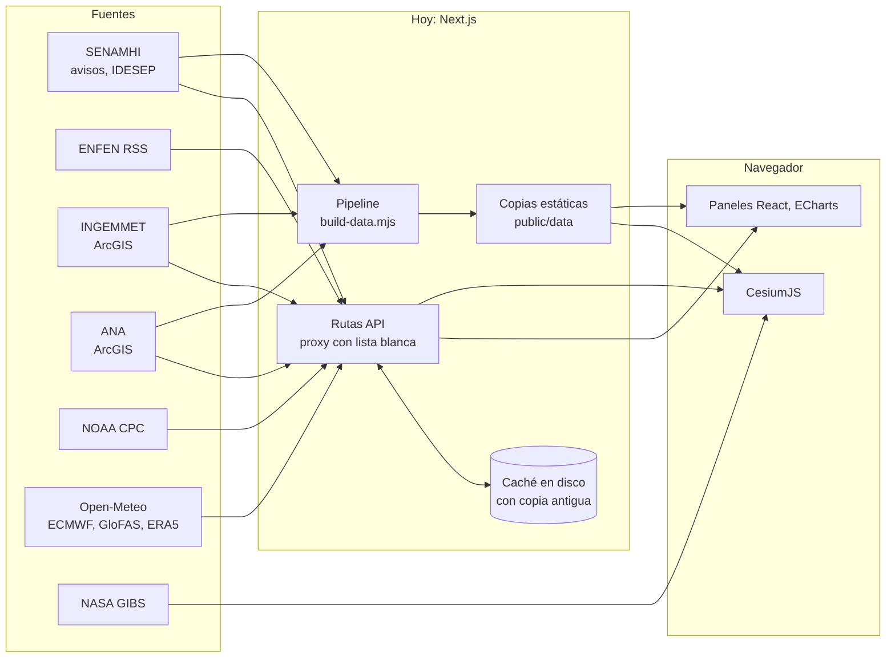
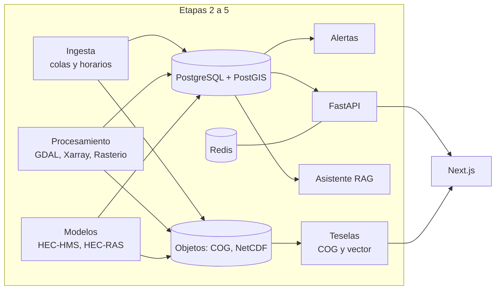

# Arquitectura general

## Principios

1. **Cada dato dice qué es.** Observación, modelo, aviso, amenaza, susceptibilidad, exposición e inventario son clases distintas, visibles en la interfaz y obligatorias en la base de datos.
2. **Sin relleno.** Si una fuente falla se muestra la última copia con su antigüedad, o un aviso de "no disponible". Nunca un valor inventado.
3. **Nada de índices disfrazados de probabilidad.** Para quebradas se muestra el aviso oficial de SENAMHI.
4. **El cliente no elige URLs.** El navegador pide capas por identificador; las direcciones viven en el servidor.

## Estado actual (Etapa 1) y destino

## Servicios desacoplados

| Servicio | Responsabilidad | Tecnología | Estado |
|---|---|---|---|
| Web | Interfaz y visor | Next.js 16, CesiumJS, ECharts | Funciona |
| Proxy y caché | Acceso a fuentes con lista blanca | Rutas API de Next.js | Funciona; migrará a la API |
| API | Catálogo, series, análisis | FastAPI | Esqueleto con pruebas |
| Base | Datos con procedencia | PostgreSQL + PostGIS | Esquema validado, sin datos |
| Ingesta | Descarga programada y registro | Python | Pendiente |
| Procesamiento | Raster a COG, agregaciones | GeoPandas, Rasterio, Xarray, GDAL | Pendiente |
| Modelos | Simulaciones por cuenca | HEC-HMS, HEC-RAS 2D | Pendiente |
| Alertas | Avisos nuevos y cambios | Python, Redis | Pendiente |
| Asistente | Preguntas con fuentes | RAG con herramientas controladas | Pendiente |

## Resiliencia

Medido durante la construcción: conexiones TCP que caen en hosts aleatorios, servicios ArcGIS de más de 60 s, y `www.senamhi.gob.pe` intermitente.

- **Reintentos** solo ante fallos de conexión, con espera creciente. Un HTTP 5xx no se reintenta.
- **Copia antigua.** Si falla la fuente, se sirve la última copia válida y la interfaz lo indica.
- **Límite por host:** 4 peticiones simultáneas.
- **Validación de respuestas.** GeoServer y ArcGIS devuelven errores con estado 200: lo que no es imagen no se cachea.
- **Estado por capa.** Cada capa muestra si carga, falla o no tiene dato para esa fecha.

## Seguridad

- Proxy cerrado: identificador de capa contra registro, rectángulo limitado a Perú, tamaño fijo.
- La API de Python solo acepta GET y limita CORS.
- TLS siempre verificado.
- Servicios de datos ligados a `127.0.0.1` en `docker-compose.yml`; las contraseñas se exigen por entorno.

## Límites de cuota

La malla nacional usa ~250 puntos por 29 días cada 6 h, unas 2000 llamadas ponderadas al día frente al límite de 10 000 de Open-Meteo. El peso exacto de las llamadas multipunto no está documentado en sus términos: hay que medirlo con tráfico real. En la Etapa 2 esta malla debe pasar a ECMWF Open Data.
