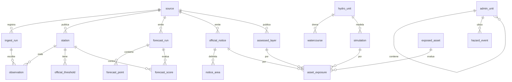

# Modelo de datos

Esquema completo en [backend/db/schema.sql](../backend/db/schema.sql). PostgreSQL 16 con PostGIS 3.

**Validación:** se aplicó sobre PostgreSQL WASM (PGlite) con PostGIS 3.6 y se comprobó que las restricciones rechazan los casos de abajo. **Falta** ejecutarlo en el contenedor `postgis/postgis:16-3.4`, porque la máquina de desarrollo no tiene Docker.



## Reglas que impone la base

| Regla del proyecto | Cómo se impone |
|---|---|
| No extrapolar pronósticos | Un disparador rechaza `lead_h` mayor que `max_lead_h` de su corrida |
| Conservar versiones de pronóstico | `forecast_run` por emisión, `UNIQUE (model, issued_at)`, nada se sobrescribe |
| Datos demo nunca como observación | `is_demo`; la API lee de `public_observation`, que los excluye |
| Exposición, daño y afectación son distintos | Tipo `exposure_state`; `afectacion_confirmada` exige `evidence_url` |
| La exposición debe venir de algo | Exige capa, aviso o simulación |
| Simulación válida | `validated` exige `validation_url` |
| Riesgo con criterio verificable | `assessed_layer.method_url` obligatorio; clase limitada a amenaza, susceptibilidad, exposición o riesgo |
| Umbrales solo oficiales | `official_threshold.document_url` obligatorio |
| Noticias diferenciadas | Tipo `verification`; por defecto `no_verificado` |
| Procedencia | `ingest_run` con URL y suma de verificación; `source` obligatoria |

## Consultas de exposición previstas

Se ejecutan con parámetros fijos desde herramientas, nunca con SQL generado por el modelo de lenguaje.

```sql
-- ¿Qué puentes coinciden con polígonos del aviso de quebradas?
SELECT a.id, a.name, n.level_label
FROM exposed_asset a
JOIN notice_area n ON ST_Intersects(a.geom, n.geom)
WHERE a.kind = 'puente' AND n.notice_id = $1;

-- ¿Qué carreteras cruzan una simulación validada del río Piura?
-- La inundación se vectoriza desde el COG y se guarda como capa antes de consultar.
```

La respuesta debe decir "exposición potencial". No es daño esperado ni afectación confirmada.

## Cargas pendientes

Hoy las tablas están vacías; la app usa archivos en `public/data`. La primera migración debe cargar `admin_unit`, `hydro_unit`, `watercourse`, `station` y `hazard_event` desde esos archivos y registrar `ingest_run`.
